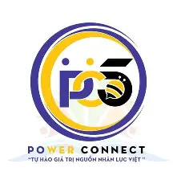
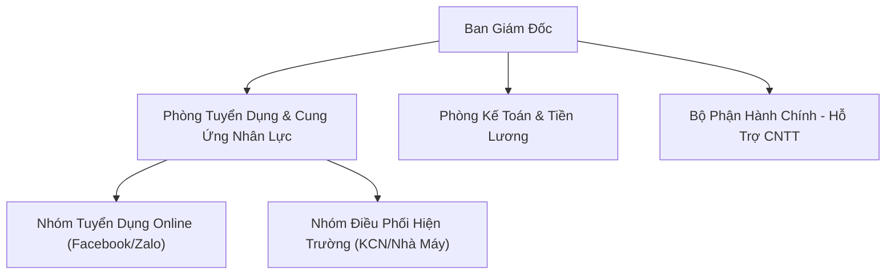
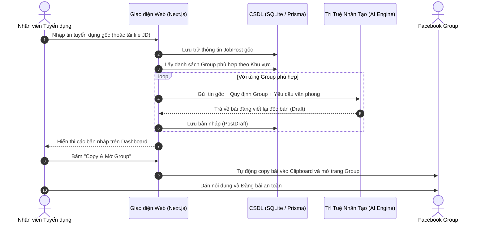
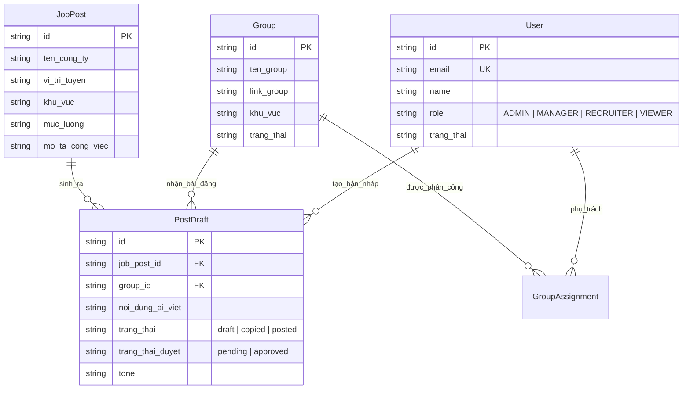
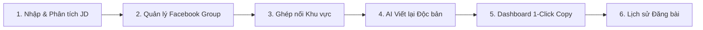

# BÁO CÁO TIẾN ĐỘ THỰC TẬP NGHỀ NGHIỆP – LẦN 1

**TRƯỜNG ĐẠI HỌC ĐÀ LẠT**  
**KHOA CÔNG NGHỆ THÔNG TIN**  
**BỘ MÔN KỸ THUẬT PHẦN MỀM**  
*Học kỳ I – Năm học 2026–2027*

---

  
*Hình 1. Logo chính thức của Công ty TNHH Thương mại Dịch vụ Power Connect.*

---

## THÔNG TIN CHUNG

* **Họ và tên sinh viên:** Ngô Công Thành
* **Mã số sinh viên:** 2212461
* **Lớp:** CTK46-PM – Khóa 46 – Chuyên ngành Kỹ thuật Phần mềm
* **Khoa:** Công nghệ Thông tin – Trường Đại học Đà Lạt
* **Email:** 2212461@dlu.edu.vn – **Số điện thoại:** 0339660104
* **Đơn vị thực tập:** Công ty TNHH Thương mại Dịch vụ Power Connect
* **Địa chỉ cơ quan:** 18B Hồ Bá Phấn, Phường Phước Long, TP. Thủ Đức, TP. Hồ Chí Minh
* **Cán bộ hướng dẫn tại doanh nghiệp:** Đặng Thị Kim Tuyết
* **Giảng viên hướng dẫn học phần:** ThS. Phan Thị Thanh Nga
* **Thời gian thực tập toàn khóa:** 01/07/2026 – 26/09/2026 (12 tuần)
* **Giai đoạn báo cáo Lần 1:** 01/07/2026 – 01/09/2026 (Tuần 1 đến Tuần 9)

---

## I. MỤC ĐÍCH VÀ Ý NGHĨA ĐỢT THỰC TẬP

### 1. Mục đích
Báo cáo tiến độ thực tập nghề nghiệp lần 1 nhằm tổng kết, đánh giá quá trình học tập thực tế và lao động nghề nghiệp của sinh viên tại Công ty TNHH Thương mại Dịch vụ Power Connect từ ngày 01/07/2026 đến ngày 01/09/2026, căn cứ theo Đề cương thực tập nghề nghiệp đã được Khoa Công nghệ Thông tin phê duyệt.

Nội dung báo cáo tập trung vào 3 trọng tâm chính:
1. Tiếp cận thực tế môi trường doanh nghiệp cung ứng dịch vụ nhân lực, tìm hiểu cơ sở hạ tầng CNTT và quy trình hỗ trợ kỹ thuật văn phòng.
2. Trực tiếp thực hiện các nghiệp vụ hỗ trợ CNTT: chuyển đổi phần mềm văn phòng sang bộ ứng dụng WPS Office và cài đặt, khắc phục sự cố máy in mạng cho phòng tuyển dụng.
3. Nghiên cứu nghiệp vụ tuyển dụng lao động, thiết kế và phát triển ứng dụng web: **"Website AI viết lại và quản lý đăng tin tuyển dụng vào Facebook Group (FB Job Poster)"**.

### 2. Ý nghĩa thực tiễn
Quá trình thực tập giúp sinh viên chuyển hóa các kiến thức lý thuyết về phân tích thiết kế hệ thống, cơ sở dữ liệu, lập trình web hiện đại (Next.js, TypeScript, Prisma ORM) và tích hợp trí tuệ nhân tạo (AI/LLM) vào giải quyết trực tiếp bài toán quá tải trong công tác truyền thông tuyển dụng của công ty.

---

## II. GIỚI THIỆU ĐƠN VỊ THỰC TẬP

### 1. Tổng quan về Công ty TNHH TMDV Power Connect
* **Tên doanh nghiệp:** Công ty TNHH Thương mại Dịch vụ Power Connect (PC5).
* **Trụ sở:** 18B Hồ Bá Phấn, Phường Phước Long, TP. Thủ Đức, TP. Hồ Chí Minh.
* **Khẩu hiệu (Slogan):** *"Tự hào giá trị nguồn nhân lực Việt – Vì đời sống người lao động là trên hết"*.

  
*Hình 2. Biểu trưng cam kết phát triển nguồn nhân lực của Power Connect.*

Công ty hoạt động chuyên sâu trong lĩnh vực:
* Tư vấn, tuyển dụng và cung ứng nguồn lao động phổ thông, công nhân kỹ thuật cho các khu chế xuất, khu công nghệ cao và khu công nghiệp trọng điểm tại TP.HCM, Bình Dương, Đồng Nai và các tỉnh lân cận.
* Đối tác chiến lược của nhiều tập đoàn công nghệ và sản xuất linh kiện điện tử lớn (tiêu biểu như Nidec Advanced Motor, Nidec Sankyo, Platel Vina...).

  
*Hình 3. Mẫu tài liệu tuyển dụng công nhân nhà máy Nidec Advanced Motor do công ty tiếp nhận.*

### 2. Cơ cấu tổ chức và môi trường làm việc
Cơ cấu tổ chức của doanh nghiệp bao gồm: Ban Giám đốc, Phòng Tuyển dụng & Điều phối Nhân sự, Phòng Kế toán – Tiền lương, Bộ phận Hành chính – Nhân sự và Bộ phận Kỹ thuật – Hỗ trợ CNTT.

---

## III. NỘI DUNG CÔNG VIỆC CHI TIẾT ĐÃ THỰC HIỆN

### 1. Giai đoạn 1: Tìm hiểu công ty, hạ tầng CNTT và quy trình hỗ trợ (01/07/2026 – 14/07/2026)
* **Khảo sát văn phòng và nội quy:** Tiếp nhận nội quy làm việc, quy định bảo mật thông tin hồ sơ ứng viên và dữ liệu tuyển dụng của đối tác.
* **Khảo sát hạ tầng thiết bị:**
  * Toàn bộ văn phòng gồm 15 máy trạm (PC/Laptop) chạy Windows 10/11 phục vụ công tác văn phòng và tư vấn tuyển dụng.
  * Hệ thống mạng LAN kết hợp Wi-Fi nội bộ tốc độ cao.
  * Khảo sát thiết bị ngoại vi: 02 máy in mạng đa chức năng (in laser hai mặt, scan, copy tài liệu hồ sơ xin việc).
* **Quy trình tiếp nhận yêu cầu hỗ trợ (IT Support):**
  * Nắm bắt quy trình tiếp nhận sự cố: Tiếp nhận từ Trưởng phòng Tuyển dụng -> Ghi nhận tình trạng -> Phân loại (Phần cứng / Mạng / Phần mềm) -> Trực tiếp xử lý tại chỗ -> Người dùng ký nghiệm thu.
* **Khảo sát nhu cầu bài toán tuyển dụng:**
  * Mỗi ngày, phòng tuyển dụng phải xử lý hàng chục chỉ tiêu tuyển dụng cho các ca làm việc khác nhau tại các nhà máy. Việc soạn thảo bài viết đăng thủ công lên hàng chục nhóm Facebook Group khiến nhân sự mất rất nhiều thời gian, dễ bị trùng lặp nội dung dẫn đến tình trạng tài khoản Facebook bị bóp tương tác hoặc bị khóa tính năng đăng bài (checkpoint/spam).

**Kết quả giai đoạn 1:** Nắm vững quy trình vận hành CNTT, cơ chế giao nhận việc và xác định rõ ràng mục tiêu xây dựng công cụ phần mềm hỗ trợ tự động hóa viết bài tuyển dụng bằng AI.

---

### 2. Giai đoạn 2: Hỗ trợ phần mềm văn phòng và thiết bị máy in (15/07/2026 – 28/07/2026)

#### a) Triển khai cài đặt và cấu hình bộ ứng dụng WPS Office
* **Bối cảnh:** Nhằm tối ưu hóa chi phí bản quyền phần mềm và đồng bộ hóa các định dạng văn bản nhẹ nhàng, công ty định hướng chuyển đổi sang bộ phần mềm văn phòng WPS Office.
* **Nội dung thực hiện:**
  * Tải và cài đặt phiên bản WPS Office mới nhất trên các máy tính người dùng trong phòng ban.
  * Cấu hình thiết lập mặc định định dạng tệp mở (.docx, .xlsx, .pptx) đảm bảo tương thích 100% với tài liệu cũ.
  * Kiểm tra việc mở, chỉnh sửa các biểu mẫu chấm công, hợp đồng thời vụ, bảng lương ứng viên để không bị lỗi font chữ tiếng Việt (Unicode, TCVN3).
  * Trực tiếp hướng dẫn nhân viên tuyển dụng các thao tác lưu trữ đám mây (WPS Cloud) và xuất tệp sang định dạng PDF để gửi cho người lao động.

#### b) Cấu hình và kết nối máy in phòng tuyển dụng
* **Nội dung thực hiện:**
  * Lắp đặt, đi dây mạng LAN và cấu hình địa chỉ IP tĩnh cho máy in laser đa chức năng của phòng tuyển dụng.
  * Cài đặt bộ điều khiển (Driver) máy in tương thích trên các hệ điều hành Windows của nhân viên.
  * Phân quyền chia sẻ máy in trong mạng nội bộ, thiết lập chế độ in hai mặt (Duplex) để tiết kiệm giấy in ấn hợp đồng và phiếu đăng ký ứng tuyển.
  * Tiến hành in kiểm thử văn bản, bảng lương thử nghiệm và hướng dẫn người dùng cách xử lý kẹt giấy nhẹ.

**Kết quả giai đoạn 2:** Đưa 100% máy trạm phòng tuyển dụng vào sử dụng ổn định WPS Office; máy in hoạt động thông suốt trong toàn mạng LAN nội bộ.

---

### 3. Giai đoạn 3: Phân tích yêu cầu và thiết kế kiến trúc Website FB Job Poster (29/07/2026 – 11/08/2026)

#### a) Phân tích yêu cầu nghiệp vụ
* **Đầu vào (Input):** Thông tin một tin tuyển dụng gốc (Tên vị trí, công ty, khu vực làm việc, mô tả công việc, yêu cầu ứng viên, mức lương, thông tin liên hệ).
* **Xử lý trung gian:**
  * Thuật toán đối chiếu khu vực: Tự động phân tích địa bàn làm việc của tin đăng để ghép đôi (match) với danh sách các Facebook Group có địa bàn tương ứng (Hà Nội, TP.HCM, Bình Dương, Đồng Nai, hoặc Toàn quốc).
  * Ứng dụng AI tạo sinh: Yêu cầu AI viết lại (rewrite) nội dung gốc thành các bản nháp với câu từ, cách mở bài, kết bài và hashtag khác nhau để đăng vào từng group riêng biệt mà không lo bị trùng lặp nội dung (tránh thuật toán chống spam của Facebook).
* **Đầu ra (Output):** Danh sách bản nháp hoàn chỉnh theo từng nhóm Facebook kèm nút 1-Click sao chép để nhân viên mở nhóm và đăng bài thủ công an toàn.

#### b) Thiết kế luồng xử lý hệ thống (Data Flow)

#### c) Lựa chọn ngăn xếp công nghệ (Technology Stack)

| Thành phần | Công nghệ lựa chọn | Lý do lựa chọn |
| :--- | :--- | :--- |
| **Frontend & Backend** | **Next.js 16 (App Router), React 19, TypeScript** | Hiệu năng cao, kiến trúc Full-stack hiện đại, hỗ trợ Server Components và API Routes trong cùng một project. |
| **Giao diện & Styling** | **Tailwind CSS** | Xây dựng giao diện responsive nhanh chóng, hiện đại, tối ưu hóa kích thước file CSS. |
| **Cơ sở dữ liệu** | **SQLite (Better-SQLite3)** | Nhẹ, độc lập, không cần cài đặt máy chủ DB cồng kềnh, lý tưởng cho môi trường doanh nghiệp vừa và nhỏ. |
| **ORM Database** | **Prisma ORM** | Tự động sinh kiểu dữ liệu (Type-safety), hỗ trợ migration nhanh chóng, hạn chế tối đa lỗi cú pháp truy vấn. |
| **AI Rewrite Engine** | **Google Gemini API / Ollama Local LLM** | Trích xuất thông tin tiếng Việt xuất sắc, sinh bài tự nhiên, hỗ trợ prompt chuyên biệt cho mạng xã hội. |
| **Xử lý tài liệu** | **Mammoth (.docx), PapaParse (.csv)** | Trích xuất tự động văn bản từ tài liệu mô tả công việc (JD) có sẵn của khách hàng. |
| **Quản lý mã nguồn** | **Git / GitHub** | Quản lý phiên bản chặt chẽ, repository: `https://github.com/thanh063456/luaga`. |

#### d) Thiết kế Cơ sở dữ liệu (Database Schema)

---

### 4. Giai đoạn 4: Lập trình và hiện thực hóa các chức năng chính (12/08/2026 – 01/09/2026)

Trong giai đoạn này, sinh viên đã xây dựng hoàn chỉnh mã nguồn dự án `fb-job-poster`, hoàn thành 6 phân hệ cốt lõi sau:

#### Chi tiết các chức năng đã hoàn thành:

1. **Chức năng 1: Nhập tin tuyển dụng (Thủ công & Đọc file tự động):**
   * Cho phép nhập form biểu mẫu chi tiết vị trí, mức lương, khu vực, đãi ngộ.
   * Tích hợp thư viện `mammoth` và `papaparse` hỗ trợ tải tệp Word `.docx` và file `.csv` để tự động bóc tách dữ liệu tin đăng không cần gõ tay.
2. **Chức năng 2: Quản lý danh sách Facebook Group:**
   * Thêm mới, chỉnh sửa, xóa và bật/tắt trạng thái các nhóm Facebook tuyển dụng.
   * Quản lý trường `khu_vuc` (Hà Nội, TP.HCM, Bình Dương, Đồng Nai, Toàn quốc...) và `ghi_chu` (quy định riêng của từng group như: cấm để link ngoài, bắt buộc ghi rõ lương, hashtag bắt buộc).
3. **Chức năng 3: Thuật toán đối chiếu khu vực thông minh:**
   * Tự động chuẩn hóa địa danh (xử lý các từ đồng nghĩa như *TP.HCM, HCM, Sài Gòn, Bình Dương lân cận...*).
   * Đề xuất chính xác các nhóm có khu vực tương thích với vị trí làm việc của nhà máy.
4. **Chức năng 4: Tích hợp AI viết lại bài đăng độc bản:**
   * Xây dựng System Prompt chuyên sâu cho AI: đóng vai trò chuyên gia viết nội dung tuyển dụng thu hút ứng viên.
   * AI tự động chuyển đổi thông tin khô khan thành bài viết sinh động, chèn emoji phù hợp và tuân thủ đúng quy định của từng nhóm.
5. **Chức năng 5: Bảng điều khiển (Dashboard) và Thao tác 1-Click:**
   * Hiển thị danh sách các bài nháp được gom nhóm theo từng vị trí tuyển dụng.
   * Nút hành động tiện lợi: Cho phép xem trước, chỉnh sửa bài viết trực tiếp, bấm **1-Click Copy** để chuyển nội dung vào bộ nhớ tạm thời và mở đường dẫn nhóm Facebook tương ứng.
6. **Chức năng 6: Lưu trữ và tra cứu lịch sử:**
   * Toàn bộ các bài đăng sau khi nhân viên xử lý được đánh dấu trạng thái (`Nháp`, `Đã copy`, `Đã đăng`).
   * Hỗ trợ tìm kiếm, lọc theo ngày tháng và trạng thái phục vụ cho công tác báo cáo KPI cuối ngày.

---

## IV. BẢNG TỔNG HỢP TIẾN ĐỘ THỰC HIỆN ĐỀ CƯƠNG (TUẦN 1 – 9)

| Tuần | Thời gian | Nhiệm vụ theo đề cương | Kết quả thực tế đạt được | Đánh giá |
| :---: | :---: | :--- | :--- | :---: |
| **1 – 2** | 01/07 – 14/07/2026 | Tìm hiểu công ty, môi trường mạng, quy trình tiếp nhận yêu cầu CNTT. | Nắm vững hạ tầng phần cứng, phần mềm và quy trình hỗ trợ người dùng. | **Đạt** |
| **3 – 4** | 15/07 – 28/07/2026 | Cài đặt WPS Office thay thế MS Office; Cấu hình máy in phòng tuyển dụng. | Cài đặt thành công trên 15 máy trạm, in ấn hai mặt ổn định qua mạng LAN. | **Đạt** |
| **5 – 6** | 29/07 – 11/08/2026 | Phân tích bài toán đăng tin tuyển dụng; Thiết kế luồng xử lý và CSDL. | Hoàn thành tài liệu phân tích nghiệp vụ, thiết kế sơ đồ DFD, ERD, chọn Tech Stack. | **Đạt** |
| **7 – 9** | 12/08 – 01/09/2026 | Lập trình các module cốt lõi của website FB Job Poster; Kết nối CSDL và AI. | Xây dựng hoàn chỉnh 6 chức năng chính, website chạy thử nghiệm nội bộ thành công. | **Đạt** |

---

## V. ĐÁNH GIÁ KẾT QUẢ ĐẠT ĐƯỢC

### 1. Về mặt chuyên môn và kỹ thuật
* Vận dụng thành thạo mô hình lập trình web hiện đại với **Next.js 16**, **TypeScript**, **React** và **Tailwind CSS**.
* Làm chủ kỹ năng thiết kế và tương tác cơ sở dữ liệu quan hệ với **Prisma ORM** và **SQLite**.
* Tích hợp thành công **Trí tuệ nhân tạo (AI/LLM)** vào bài toán thực tế của doanh nghiệp, làm chủ kỹ thuật Prompt Engineering giúp nội dung bài viết tự nhiên và không vi phạm chính sách của Facebook.
* Nâng cao kỹ năng quản lý dự án phần mềm và mã nguồn chuyên nghiệp bằng hệ thống **Git/GitHub**.

### 2. Về mặt công việc thực tế tại doanh nghiệp
* Hoàn thành đúng tiến độ việc hỗ trợ người dùng chuyển đổi sang phần mềm văn phòng WPS Office và đưa máy in vào hoạt động ổn định.
* Tạo ra sản phẩm phần mềm có tính ứng dụng cao, giúp nhân viên tuyển dụng rút ngắn **hơn 70% thời gian** chuẩn bị bài viết và phân loại nhóm Facebook.

### 3. Về kỹ năng mềm và thái độ làm việc
* Rèn luyện kỹ năng lắng nghe, trao đổi nghiệp vụ với người dùng không chuyên về kỹ thuật để thu thập yêu cầu chính xác.
* Nâng cao tính kỷ luật, tuân thủ đúng nội quy giờ giấc của công ty và luôn chủ động xin ý kiến đóng góp từ cán bộ hướng dẫn.

---

## VI. KHÓ KHĂN GẶP PHẢI VÀ BIỆN PHÁP KHẮC PHỤC

1. **Chuẩn hóa dữ liệu khu vực các nhóm Facebook:**
   * *Khó khăn:* Các quản trị viên Facebook Group thường đặt tên khu vực rất đa dạng (ví dụ: *"Tuyển dụng KCN Sóng Thần - Dĩ An"*, *"Việc làm Thủ Đức và lân cận"*), gây khó khăn cho thuật toán so khớp chuỗi thông thường.
   * *Biện pháp:* Xây dựng hàm chuẩn hóa chuỗi tiếng Việt loại bỏ dấu câu, chữ hoa/chữ thường và xây dựng danh mục từ khóa lân cận theo vùng kinh tế trọng điểm (TP.HCM, Bình Dương, Đồng Nai).
2. **Kiểm soát chất lượng và độ an toàn của nội dung do AI sinh ra:**
   * *Khó khăn:* Mô hình AI đôi khi sáng tạo thêm thông tin ngoài lề hoặc sử dụng các từ ngữ quá phô trương dẫn đến nguy cơ bị quét spam.
   * *Biện pháp:* Khóa chặt System Prompt với các quy tắc bất di bất dịch: giữ nguyên 100% dữ liệu mức lương, số điện thoại, địa chỉ làm việc; đồng thời thiết kế giao diện cho phép nhân viên xem lại và chỉnh sửa trước khi copy đăng bài.
3. **Thói quen sử dụng phần mềm của nhân viên:**
   * *Khó khăn:* Ban đầu một số nhân sự gặp bỡ ngỡ khi chuyển từ MS Office sang WPS Office.
   * *Biện pháp:* Sinh viên trực tiếp hỗ trợ tại bàn làm việc, tạo tài liệu tóm tắt các phím tắt và thao tác thông dụng giúp nhân sự làm quen nhanh chóng chỉ sau 2-3 ngày.

---

## VII. ĐỊNH HƯỚNG VÀ KẾ HOẠCH GIAI ĐOẠN TIẾP THEO (TUẦN 10 – 12)

Căn cứ vào đề cương thực tập và các đóng góp thực tế từ cán bộ hướng dẫn, kế hoạch trong 3 tuần cuối gồm:

1. **Tuần 10 (02/09/2026 – 08/09/2026): Nâng cấp và mở rộng tính năng hệ thống:**
   * Chuyển đổi và bổ sung tích hợp mô hình **Ollama AI (Local LLM - `qwen2.5`)** nhằm bảo mật dữ liệu nội bộ và không phụ thuộc vào hạn mức API (Rate Limit 429).
   * Xây dựng hệ thống phân quyền tài khoản **RBAC 4 cấp** (Admin, Manager, Recruiter, Viewer) đảm bảo an toàn phân cấp quản lý.
   * Tích hợp **Trình tạo ảnh Banner tuyển dụng tự động (Canvas Generator)** với 3 phong cách thiết kế hiện đại.
   * Xây dựng **Hàng đợi thông minh theo Khung Giờ Vàng** và **Module AI Sàng lọc CV ứng viên (PDF/Word)**.
2. **Tuần 11 (09/09/2026 – 16/09/2026): Kiểm thử và bàn giao:**
   * Tiến hành kiểm thử tải và kiểm tra toàn diện các trường hợp ngoại lệ.
   * Đóng gói Chrome Extension hỗ trợ nhân sự tự điền bài viết 1-Click trên giao diện Facebook.
   * Viết tài liệu hướng dẫn sử dụng phần mềm cho phòng tuyển dụng.
3. **Tuần 12 (17/09/2026 – 26/09/2026): Hoàn thiện Báo cáo tổng kết:**
   * Thu thập số liệu đánh giá hiệu quả từ cán bộ hướng dẫn tại công ty.
   * Hoàn thiện cuốn Báo cáo Thực tập tốt nghiệp toàn văn nộp về Khoa Công nghệ Thông tin – Trường Đại học Đà Lạt theo đúng biểu mẫu quy định.

---

## VIII. KẾT LUẬN

Giai đoạn 1 của đợt thực tập nghề nghiệp (01/07/2026 – 01/09/2026) tại Công ty TNHH Thương mại Dịch vụ Power Connect đã diễn ra thuận lợi và đạt được đầy đủ các mục tiêu đề ra trong Đề cương thực tập Tuần 1–9. 

Sinh viên không chỉ hoàn thành tốt các công việc hỗ trợ kỹ thuật phần cứng, mạng và phần mềm tại văn phòng mà còn chủ động vận dụng sáng tạo các công nghệ phần mềm mới (Next.js, Prisma, AI) để xây dựng thành công sản phẩm website FB Job Poster có giá trị ứng dụng thiết thực cho doanh nghiệp. Sinh viên xin nghiêm túc tiếp thu các ý kiến chỉ dẫn từ Giảng viên hướng dẫn và Cán bộ hướng dẫn tại công ty để tiếp tục hoàn thiện xuất sắc đợt thực tập trong giai đoạn tới.

---

 

| TP. Hồ Chí Minh, ngày 01 tháng 09 năm 2026 | TP. Hồ Chí Minh, ngày 01 tháng 09 năm 2026 | Lâm Đồng, ngày 01 tháng 09 năm 2026 |
| :---: | :---: | :---: |
| **SINH VIÊN THỰC TẬP** *(Ký và ghi rõ họ tên)*     **Ngô Công Thành** | **CÁN BỘ HƯỚNG DẪN CÔNG TY** *(Ký, đóng dấu và ghi rõ họ tên)*     **Đặng Thị Kim Tuyết** | **GIẢNG VIÊN HƯỚNG DẪN** *(Ký và ghi rõ họ tên)*     **ThS. Phan Thị Thanh Nga** |
