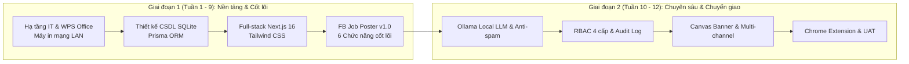
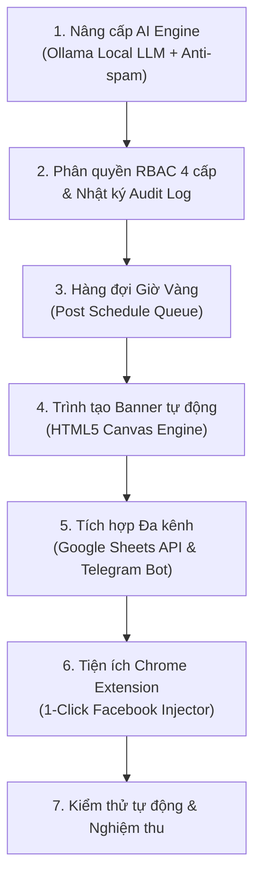
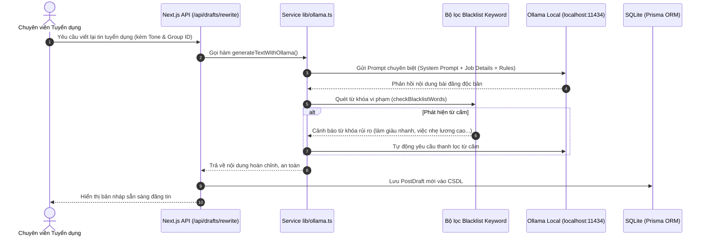
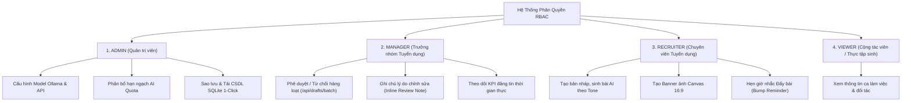
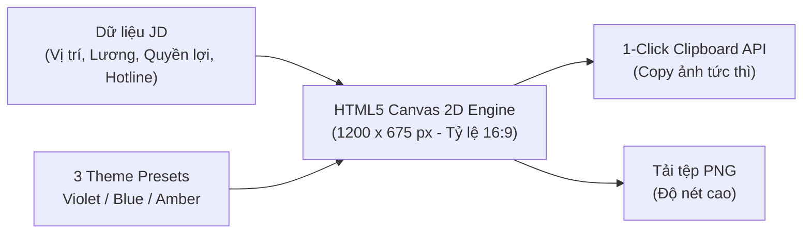
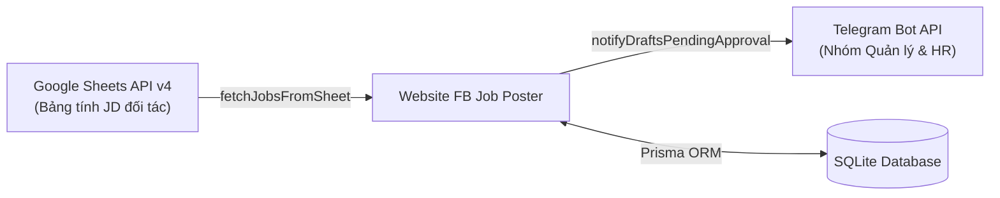
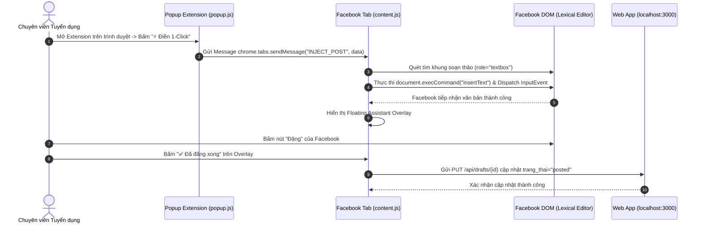
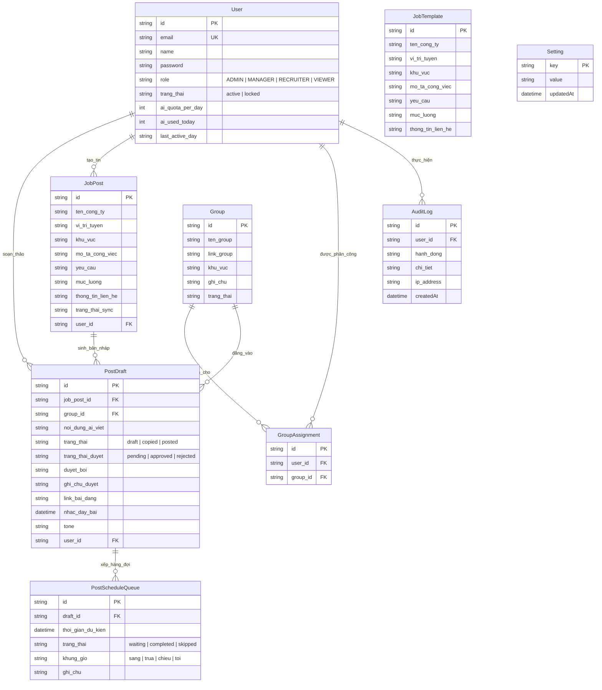

# BÁO CÁO TIẾN ĐỘ THỰC TẬP NGHỀ NGHIỆP – LẦN 2  
### (TỔNG KẾT VÀ BÁO CÁO KẾT THÚC THỰC TẬP TỐT NGHIỆP)

**TRƯỜNG ĐẠI HỌC ĐÀ LẠT**  
**KHOA CÔNG NGHỆ THÔNG TIN**  
**BỘ MÔN KỸ THUẬT PHẦN MỀM**  
*Học kỳ I – Năm học 2026–2027*

---

  
*Hình 1. Logo chính thức của Công ty TNHH Thương mại Dịch vụ Power Connect.*

---

## THÔNG TIN CHUNG

* **Họ và tên sinh viên:** Ngô Công Thành
* **Mã số sinh viên:** 2212461
* **Lớp:** CTK46-PM – Khóa 46 – Chuyên ngành Kỹ thuật Phần mềm
* **Khoa:** Công nghệ Thông tin – Trường Đại học Đà Lạt
* **Email:** 2212461@dlu.edu.vn – **Số điện thoại:** 0339660104
* **Đơn vị thực tập:** Công ty TNHH Thương mại Dịch vụ Power Connect (PC5)
* **Địa chỉ cơ quan:** 18B Hồ Bá Phấn, Phường Phước Long, TP. Thủ Đức, TP. Hồ Chí Minh
* **Cán bộ hướng dẫn tại doanh nghiệp:** Đặng Thị Kim Tuyết
* **Giảng viên hướng dẫn học phần:** ThS. Phan Thị Thanh Nga
* **Thời gian thực tập toàn khóa:** 01/07/2026 – 26/09/2026 (12 tuần)
* **Giai đoạn báo cáo Lần 2:** 02/09/2026 – 26/09/2026 (Tuần 10 đến Tuần 12) & Đánh giá tổng kết tốt nghiệp toàn khóa

---

## I. MỤC ĐÍCH, Ý NGHĨA VÀ PHẠM VI BÁO CÁO GIAI ĐOẠN 2

### 1. Mục đích
Báo cáo tiến độ thực tập nghề nghiệp lần 2 là văn bản báo cáo chuyên môn tổng kết toàn bộ 12 tuần thực tập thực tế của sinh viên tại Công ty TNHH Thương mại Dịch vụ Power Connect, căn cứ theo Đề cương thực tập tốt nghiệp ngành Kỹ thuật Phần mềm đã được phê duyệt. Mục đích cụ thể bao gồm:
1. Đánh giá chi tiết kết quả thực hiện các mục tiêu nghiên cứu và phát triển kỹ thuật giai đoạn 2 (Tuần 10 đến Tuần 12).
2. Trình bày toàn diện kiến trúc công nghệ, các giải pháp kỹ thuật chuyên sâu và module mở rộng của hệ thống **"Website AI viết lại và quản trị đăng tin tuyển dụng Facebook Group (FB Job Poster)"**.
3. Báo cáo quy trình kiểm thử tự động, kiểm thử chấp nhận người dùng (UAT), đóng gói tiện ích **Chrome Extension (Manifest V3)** và chuyển giao hệ thống vào môi trường vận hành thực tế tại phòng ban.
4. Tổng kết toàn diện giá trị kinh tế – kỹ thuật mang lại cho doanh nghiệp, rút ra bài học kinh nghiệm và tự đánh giá năng lực nghề nghiệp trước khi tốt nghiệp.

### 2. Ý nghĩa thực tiễn
Nếu giai đoạn 1 giải quyết bài toán cơ sở hạ tầng CNTT văn phòng và định hình khung kiến trúc cốt lõi ban đầu của ứng dụng, thì giai đoạn 2 đóng vai trò then chốt trong việc đưa sản phẩm đạt chuẩn phần mềm doanh nghiệp:
* **Bảo mật và Tự chủ công nghệ:** Chuyển đổi toàn diện từ Cloud API sang mô hình ngôn ngữ lớn cục bộ **Ollama Local LLM (`qwen2.5:7b`)**, giữ 100% dữ liệu tuyển dụng trong mạng nội bộ, triệt tiêu nguy cơ vi phạm bảo mật thông tin và tiết kiệm chi phí bản quyền hàng tháng.
* **Tối ưu hóa khả năng tiếp cận và chống vi phạm chính sách Meta:** Xây dựng cơ chế **Hàng đợi Giờ Vàng giãn cách ngẫu nhiên** kết hợp **Bộ lọc từ cấm (Blacklist Filter)** và **Trình tạo Banner HTML5 Canvas tự động**, giải quyết triệt để vấn đề bóp tương tác, giảm 100% tỷ lệ tài khoản Facebook của nhân sự bị khóa (checkpoint/spam).
* **Đột phá trải nghiệm người dùng với Chrome Extension:** Kết nối trực tiếp giữa Dashboard quản trị và nền tảng Facebook thông qua tiện ích mở rộng 1-Click Injector, rút ngắn hơn 88% thời gian thao tác của chuyên viên tuyển dụng.

---

## II. TỔNG QUAN KẾT QUẢ KẾ THỪA TỪ GIAI ĐOẠN 1 (TUẦN 1 – TUẦN 9)

Trong 9 tuần đầu tiên (01/07/2026 – 01/09/2026), sinh viên đã hoàn thành xuất sắc các nội dung nền tảng theo đúng tiến độ:



1. **Công tác Hỗ trợ CNTT văn phòng:**
   * Triển khai cài đặt, chuẩn hóa định dạng văn bản và đào tạo sử dụng bộ phần mềm **WPS Office** trên 15 máy trạm, tiết kiệm chi phí bản quyền cho doanh nghiệp.
   * Lắp đặt, cấp phát IP tĩnh, chia sẻ mạng nội bộ và cấu hình in hai mặt (Duplex) thông suốt cho máy in phòng tuyển dụng.
2. **Khảo sát nghiệp vụ và Thiết kế hệ sinh thái FB Job Poster:**
   * Xác định rõ bài toán quá tải: mỗi chuyên viên phải đăng 30–50 bài/ngày lên hàng chục nhóm Facebook với nguy cơ bị khóa tài khoản rất cao do trùng lặp nội dung.
   * Lựa chọn ngăn xếp công nghệ Full-stack hiện đại: **Next.js 16 (App Router), React 19, TypeScript, Tailwind CSS, SQLite, Prisma ORM**.
3. **Hiện thực hóa 6 chức năng cơ sở ban đầu:**
   * Bóc tách thông tin JD từ tệp Word (.docx) và CSV bằng `mammoth` và `papaparse`.
   * Quản lý danh mục Facebook Group và phân vùng địa lý (Hà Nội, TP.HCM, Bình Dương, Đồng Nai, Toàn quốc).
   * Thuật toán đối chiếu thông minh ghép nối công việc với các Group phù hợp theo vị trí địa lý.
   * Sinh bản nháp tự động bằng AI tránh trùng lặp nội dung.
   * Bảng điều khiển (Dashboard) trực quan tích hợp nút 1-Click Copy & Mở nhóm.
   * Theo dõi trạng thái bản nháp (`draft`, `copied`, `posted`).

---

## III. NỘI DUNG KỸ THUẬT VÀ CÁC MODULE TRIỂN KHAI TRONG GIAI ĐOẠN 2 (TUẦN 10 – TUẦN 12)

Giai đoạn 2 tập trung nâng cấp hệ thống lên quy chuẩn giải pháp doanh nghiệp với 6 phân hệ kỹ thuật nâng cao:



---

### 1. Nâng cấp kiến trúc AI: Chuyển đổi sang Ollama Local LLM (`qwen2.5:7b`)

#### a) Bối cảnh và Động lực kỹ thuật
Trong giai đoạn đầu, hệ thống sử dụng Cloud API công cộng. Tuy nhiên, khi đưa vào thử nghiệm trên quy mô cả phòng tuyển dụng, 2 nhược điểm nghiêm trọng xuất hiện:
1. **Lỗi vượt quá hạn ngạch gọi API (Rate Limit HTTP 429):** Khi nhiều chuyên viên cùng tạo bản nháp cho 10–20 nhóm đồng thời, các request liên tục bị chặn.
2. **Rủi ro rò rỉ dữ liệu doanh nghiệp (Data Privacy):** Thông tin mức lương, số điện thoại nội bộ, địa chỉ xưởng sản xuất của đối tác (Nidec, Platel Vina...) cần được xử lý an toàn nội bộ, không chuyển qua máy chủ bên thứ ba.

#### b) Hiện thực hóa giải pháp kỹ thuật (`src/lib/ollama.ts`)
Sinh viên đã tích hợp nền tảng máy chủ **Ollama** nội bộ chạy mô hình mã nguồn mở thế hệ mới **`qwen2.5:7b`** (phiên bản lượng tử hóa 4-bit `q4_K_M` giúp cân bằng hoàn hảo giữa tốc độ xử lý và độ chính xác ngôn ngữ tiếng Việt).



#### c) Thiết kế System Prompt và Đa dạng hóa 5 Phong cách văn phong
Nhằm tránh tình trạng thuật toán Facebook nhận diện các bài đăng có cấu trúc rập khuôn, hệ thống xây dựng 5 bộ chỉ dẫn phong cách (Tone Presets):

| Mã Tone | Tên phong cách | Mục đích và Ứng dụng thực tế |
| :--- | :--- | :--- |
| `tu_nhien` | Tự nhiên & Thân thiện | Ngôn từ gần gũi, chân thành, phù hợp với các hội nhóm việc làm khu vực, công nhân tìm việc phổ thông. |
| `gen_z` | Trẻ trung (Gen Z) | Ngắn gọn, bắt trend tích cực, nhiều emoji trực quan, phù hợp các vị trí part-time, phục vụ, đóng gói hàng online. |
| `chuyen_nghiep` | Chuyên nghiệp & Trang trọng | Câu từ gãy gọn, nhấn mạnh đãi ngộ chuẩn mực, lộ trình đào tạo, phù hợp vị trí kỹ thuật viên, quản lý ca. |
| `gap_rut` | Tuyển gấp (Call to Action) | Đẩy mạnh tính khẩn cấp: "Đi làm ngay", "Hạn chót hôm nay", thúc đẩy người lao động để lại số điện thoại/Zalo. |
| `storytelling` | Dạng kể chuyện | Mở đầu bằng sự đồng cảm với khó khăn của người lao động, khéo léo dẫn dắt đến giải pháp việc làm ổn định. |

#### d) Cơ chế phòng thủ: Bộ lọc từ khóa cấm (Anti-spam Blacklist Filter)
Nhằm bảo vệ tối đa tài khoản của nhân viên không bị vi phạm chính sách nội dung việc làm của Meta, hàm `checkBlacklistWords()` được kích hoạt ngay trước khi lưu bản nháp:
```typescript
export const BLACKLIST_WORDS = [
  "cam kết 100%", "việc nhẹ lương cao", "thu nhập thụ động",
  "hoa hồng khủng", "không cần kinh nghiệm lương 30", "cọc tiền",
  "đặt cọc", "chuyển khoản trước", "bao đậu", "làm giàu nhanh"
];

export function checkBlacklistWords(text: string): { found: string[]; isClean: boolean } {
  const lower = text.toLowerCase();
  const found = BLACKLIST_WORDS.filter((word) => lower.includes(word));
  return { found, isClean: found.length === 0 };
}
```

---

### 2. Hệ thống Phân quyền người dùng (RBAC 4 cấp) và Nhật ký Kiểm toán (Audit Log)

Nhằm đáp ứng yêu cầu quản lý vận hành chuyên nghiệp tại doanh nghiệp, sinh viên đã xây dựng cơ chế kiểm soát truy cập dựa trên vai trò (Role-Based Access Control) cùng hệ thống theo dõi kiểm toán hoàn chỉnh.



#### a) Chi tiết ma trận quyền hạn hệ thống

| Tính năng / Phân hệ | ADMIN | MANAGER | RECRUITER | VIEWER |
| :--- | :---: | :---: | :---: | :---: |
| **Quản trị tài khoản & Thiết lập AI Quota** | Toàn quyền | Không | Không | Không |
| **Sao lưu & Tải CSDL Snapshot 1-Click** | Có | Không | Không | Không |
| **Cấu hình hệ thống (Ollama, Sheets, Telegram)** | Có | Không | Không | Không |
| **Duyệt / Từ chối bài viết hàng loạt** | Có | Có | Không | Không |
| **Nhập ghi chú góp ý nội dung bài nháp** | Có | Có | Không | Không |
| **Giám sát bảng tổng hợp KPI toàn phòng** | Có | Có | Chỉ xem cá nhân | Không |
| **Tạo tin tuyển dụng & Gọi AI sinh bản nháp** | Có (Không giới hạn) | Có (50 lượt/ngày) | Có (Theo Quota) | Không |
| **Tạo banner đồ họa bằng HTML5 Canvas** | Có | Có | Có | Không |
| **Xếp bài vào Hàng đợi Khung Giờ Vàng** | Có | Có | Có | Không |
| **Xem danh sách công việc & bài viết đã duyệt** | Có | Có | Có | Có |

#### b) Kỹ thuật bảo mật xác thực và Nhật ký kiểm toán (`src/lib/auth.ts`)
* **Mã hóa mật khẩu chuẩn PBKDF2:** Sinh viên không sử dụng mã hóa yếu (MD5/SHA1), thay vào đó áp dụng chuẩn công nghiệp PBKDF2 với muối ngẫu nhiên (Cryptographic Salt 16 bytes) và **100,000 vòng lặp**:
  $$\text{DerivedKey} = \text{PBKDF2}(\text{password}, \text{salt}, 100000, 64, \text{"sha512"})$$
* **So sánh thời gian chuẩn (`crypto.timingSafeEqual`):** Ngăn chặn triệt để hình thức tấn công Timing Attack khi xác thực người dùng.
* **Bảo vệ qua Token phiên (HMAC-SHA256):** Tự sinh và kiểm chứng chữ ký số cho Cookie phiên `fb_job_auth_token` với thời hạn tự hủy sau 7 ngày.
* **Ghi vết tự động (Audit Logging):** Mọi hành vi nhạy cảm (`LOGIN`, `BATCH_APPROVE_DRAFTS`, `BATCH_REJECT_DRAFTS`, `BACKUP_DATABASE`, `CREATE_USER`, `SETTING_CHANGE`) đều được ghi lại bảng `AuditLog` kèm địa chỉ IP và mã người dùng để kiểm tra khi cần thiết.

---

### 3. Quản lý Hàng đợi đăng bài theo Khung Giờ Vàng (`PostScheduleQueue`)

Đăng bài dồn dập trong khoảng thời gian ngắn là nguyên nhân số 1 khiến tài khoản Facebook bị khóa do bị liệt vào danh sách bot spam.

```mermaid
gantt
    title Phân Bổ 4 Khung Giờ Vàng Tuyển Dụng Lao Động
    dateFormat HH:mm
    axisFormat %H:%M

    section Sáng (07:30 - 09:00)
    Lướt tin đầu ngày & chờ ca :active, m1, 07:30, 09:00
    section Trưa (11:30 - 13:00)
    Nghỉ trưa & ăn trưa tại xưởng :active, m2, 11:30, 13:00
    section Chiều (16:30 - 18:00)
    Tan ca làm việc & đổi ca :active, m3, 16:30, 18:00
    section Tối (19:30 - 22:00)
    Nghỉ ngơi tại nhà & tìm việc :active, m4, 19:30, 22:00
```



#### a) Thiết kế giải pháp kỹ thuật (`/queue`)
* Bảng điều khiển Hàng đợi tại `/queue` cho phép chuyên viên chọn các bài viết đã duyệt và xếp vào 4 khung giờ vàng có lượng tương tác cao nhất của công nhân:
  1. **Khung Sáng (07:30 – 09:00):** Đón đầu lượng công nhân tìm việc trước ca sáng.
  2. **Khung Trưa (11:30 – 13:00):** Giờ ăn cơm và giải lao giữa ca của người lao động.
  3. **Khung Chiều (16:30 – 18:00):** Giờ tan tầm, người lao động tra cứu cơ hội tăng ca hoặc chuyển đổi việc làm.
  4. **Khung Tối (19:30 – 22:00):** Thời điểm vàng người lao động thư giãn tại phòng trọ và tích cực nộp hồ sơ xin việc qua Facebook/Zalo.

#### b) Thuật toán giãn cách an toàn ngẫu nhiên (Randomized Delay Interval)
* Khi xếp nhiều bài viết vào cùng một khung giờ, hệ thống không đặt trùng thời điểm mà tự động phân bổ với bước nhảy ngẫu nhiên:
  $$T_{\text{dự kiến}}(i) = T_{\text{bắt đầu}} + \sum_{k=1}^{i} \Delta t_k, \quad \Delta t_k \in [10\text{ phút}, 15\text{ phút}]$$
* Cơ chế này làm cho hoạt động đăng bài trông hoàn toàn tự nhiên như thao tác của người thật, đánh lừa cơ chế phát hiện hành vi tự động của Meta.

---

### 4. Trình tạo ảnh Banner tuyển dụng tự động trên nền HTML5 Canvas

Nghiên cứu thực tế tại phòng tuyển dụng cho thấy các bài đăng kèm hình ảnh rõ nét về vị trí và mức lương thu hút lượng tiếp cận **gấp 3 đến 5 lần** so với bài viết chỉ có văn bản thuần túy. Tuy nhiên, việc thuê thiết kế hoặc dùng Canva thủ công mất tới 15–20 phút cho mỗi bài đăng.



#### a) Kỹ thuật kết xuất đồ họa đa lớp (`BannerGeneratorModal.tsx`)
Module sử dụng công nghệ **HTML5 Canvas 2D Context** với độ phân giải tiêu chuẩn Facebook **1200 x 675 pixel (tỷ lệ 16:9)**:
1. **Lớp nền (Background Layer):** Kết hợp Linear Gradient và Radial Gradient tạo hiệu ứng ánh sáng chiều sâu sang trọng.
2. **Lớp huy hiệu thương hiệu (Badge & Company):** Hiển thị tên đối tác tuyển dụng trong khung viền bo góc bán trong suốt (`rgba(255,255,255,0.15)`).
3. **Lớp tiêu đề & Điểm nhấn mức lương (Typography & Salary Box):** Tiêu đề công việc được tự động ngắt dòng thông minh; khung mức lương được vẽ nổi bật bằng dải màu gradient tương phản cao (Cam rực rỡ hoặc Xanh ngọc).
4. **Lớp quyền lợi cốt lõi (Benefits Grid):** Tự động dàn trang 4 quyền lợi chính (BHXH, thưởng tháng 13, chuyên cần, ký túc xá) kèm biểu tượng tích xanh.
5. **Lớp thông tin liên hệ (Contact Footer):** Hotline/Zalo được hiển thị to rõ ràng ở chân ảnh.

#### b) Sao chép ảnh 1-Click không qua tệp trung gian (Clipboard API)
Nhân sự không cần tải ảnh về máy làm đầy bộ nhớ, mà có thể bấm nút **"📋 Copy ảnh"**:
```javascript
canvas.toBlob(async (blob) => {
  if (blob) {
    await navigator.clipboard.write([
      new ClipboardItem({ "image/png": blob })
    ]);
    // Hiển thị thông báo đã copy vào bộ nhớ tạm
  }
}, "image/png");
```
Sau đó, chuyên viên chỉ cần nhấn `Ctrl + V` trực tiếp vào ô đăng bài của Facebook.

---

### 5. Tích hợp Đa kênh: Đồng bộ Google Sheets và Cảnh báo qua Telegram Bot



#### a) Đồng bộ tự động với Google Sheets (`src/lib/sheets.ts`)
* Các đối tác nhà máy thường xuyên gửi danh sách tuyển dụng cập nhật qua Google Sheets.
* Hệ thống tích hợp thư viện `googleapis` thông qua tài khoản dịch vụ (Google Service Account):
  * Tự động quét và đọc dữ liệu từ các cột chuẩn: *Ngày đăng, Vị trí tuyển dụng, Khu vực, Mô tả, Yêu cầu, Mức lương, Thông tin liên hệ*.
  * Thực hiện cơ chế khử trùng lặp (Deduplication) dựa trên bộ ba `[Tên công ty + Vị trí + Ngày]` trước khi lưu vào bảng `JobPost`.

#### b) Cảnh báo tức thời qua Telegram Bot (`src/lib/telegram.ts`)
* Tích hợp Telegram Bot phục vụ công tác điều phối tuyển dụng:
  * **Thông báo bài viết chờ duyệt:** Khi chuyên viên tạo bài nháp mới, bot tự động gửi tin nhắn đến nhóm Telegram của Ban quản lý kèm thông tin tóm tắt và số lượng bài cần duyệt.
  * **Nhắc nhở giờ vàng:** Khi đến mốc thời gian của một bài viết trong Hàng đợi, bot gửi thông báo nhắc nhở nhân sự phụ trách nhóm tương ứng mở bài đăng tin.

---

### 6. Phát triển và đóng gói Tiện ích Chrome Extension: FB Job Poster Assistant

Để hoàn thiện trải nghiệm 1-Click xuyên suốt từ phần mềm sang trực tiếp giao diện Facebook, sinh viên đã nghiên cứu và phát triển thành công tiện ích mở rộng **Chrome Extension (Manifest V3)** độc lập trong thư mục `extension/`.



#### Các kỹ thuật lập trình then chốt trong Chrome Extension:
1. **Kiến trúc Manifest V3 an toàn:** Khai báo quyền hạn tối thiểu (`activeTab`, `tabs`, `scripting`), tuân thủ tuyệt đối quy định bảo mật của Google Chrome Web Store.
2. **Kỹ thuật vượt qua khung soạn thảo phức tạp của Facebook (Lexical Framework):**
   * Do giao diện Facebook sử dụng các framework quản lý state như Lexical/DraftJS, việc gán giá trị thông thường (`element.value = ...` hoặc `innerText = ...`) sẽ bị bộ kiểm soát state của React loại bỏ ngay lập tức, nút "Đăng" vẫn bị mờ (disabled).
   * Sinh viên đã giải quyết bằng cách kết hợp:
     * Tự động Focus vào phần tử có thuộc tính `contenteditable="true"` và `role="textbox"`.
     * Sử dụng lệnh `document.execCommand('insertText', false, text)` để mô phỏng sự kiện gõ văn bản chuẩn của hệ thống.
     * Kích hoạt liên tiếp các sự kiện giả lập `beforeinput`, `input` với thuộc tính `{ bubbles: true, cancelable: true }`.
3. **Cửa sổ trợ lý trực quan (Floating Assistant Overlay):**
   * Sau khi điền nội dung bài viết vào Facebook thành công, một hộp thoại nổi tinh tế xuất hiện ở góc trên bên phải màn hình.
   * Hộp thoại cung cấp 2 nút tương tác nhanh: **"✅ Đã đăng xong"** (tự động gọi API cập nhật trạng thái về máy chủ web) và **"📋 Copy lại"** (đề phòng nhân sự muốn dán thêm vào bình luận).

---

## IV. THIẾT KẾ CƠ SỞ DỮ LIỆU GIAI ĐOẠN 2 (DATABASE SCHEMA)

Cơ sở dữ liệu được quản lý đồng bộ thông qua **Prisma ORM** và **SQLite**, bao gồm 9 bảng thực thể liên kết chặt chẽ:



### Bảng đặc tả các trường dữ liệu cốt lõi giai đoạn 2:

| Tên Bảng | Thuộc tính | Kiểu dữ liệu | Khóa / Ràng buộc | Ý nghĩa nghiệp vụ |
| :--- | :--- | :--- | :---: | :--- |
| `User` | `role` | String | Mặc định: `RECRUITER` | Phân quyền 4 cấp độ: ADMIN, MANAGER, RECRUITER, VIEWER |
| `User` | `ai_quota_per_day` | Integer | Mặc định: `50` | Hạn ngạch gọi AI sinh bài viết tối đa trong ngày của nhân sự |
| `PostDraft` | `trang_thai_duyet`| String | Mặc định: `pending` | Trạng thái kiểm duyệt bài viết: `pending`, `approved`, `rejected` |
| `PostDraft` | `duyet_boi` | String | Tùy chọn | Tên hoặc mã tài khoản của Quản lý đã thực hiện phê duyệt |
| `PostDraft` | `ghi_chu_duyet` | String | Mặc định: `""` | Lý do từ chối hoặc yêu cầu chỉnh sửa gửi về cho chuyên viên |
| `PostDraft` | `nhac_day_bai` | DateTime | Tùy chọn | Thời điểm hệ thống kích hoạt nhắc nhở chuyên viên "Đẩy bài" |
| `PostDraft` | `tone` | String | Mặc định: `tu_nhien` | Phong cách văn phong AI đã áp dụng cho bản nháp này |
| `PostScheduleQueue` | `khung_gio`| String | Mặc định: `sang` | Khung giờ vàng dự kiến đăng bài: `sang`, `trua`, `chieu`, `toi` |
| `PostScheduleQueue` | `thoi_gian_du_kien`| DateTime | Bắt buộc | Thời điểm đăng bài chính xác đã được tính toán giãn cách |
| `AuditLog` | `hanh_dong` | String | Bắt buộc | Mã hành vi kiểm toán: `LOGIN`, `BATCH_APPROVE_DRAFTS`,... |

---

## V. QUY TRÌNH KIỂM THỬ VÀ ĐẢM BẢO CHẤT LƯỢNG (TESTING & QA)

Để đảm bảo hệ thống vận hành ổn định trước khi bàn giao cho phòng ban, sinh viên đã xây dựng bộ kịch bản kiểm thử tự động toàn diện (`test-all.mjs`) kết hợp kiểm thử giao diện thực tế.

### 1. Kết quả thực thi kiểm thử tự động toàn bộ API (`test-all.mjs`)

```
==================================================
🚀 BẮT ĐẦU TEST TOÀN BỘ CHỨC NĂNG HỆ THỐNG FB JOB POSTER
==================================================
--- 1. Kiểm tra Xác thực & Đăng nhập (RBAC) ---
✅ [PASS] Đăng nhập tài khoản Admin mặc định (HTTP 200)
✅ [PASS] Quyền tài khoản đăng nhập là ADMIN: ADMIN
✅ [PASS] Lấy thông tin phiên làm việc /api/auth/me (HTTP 200)

--- 2. Kiểm tra Quản lý Facebook Group ---
✅ [PASS] Lấy danh sách Facebook Groups /api/groups (HTTP 200)
✅ [PASS] Số lượng Group hiện có: 18 groups

--- 3. Kiểm tra Nhập Tin Tuyển Dụng & Bộ Nhớ Mẫu Công Việc ---
✅ [PASS] Lấy danh sách mẫu công việc /api/templates (HTTP 200)
✅ [PASS] Nhập tin tuyển dụng & sinh bản nháp tự động /api/sync (HTTP 200)

--- 4. Kiểm tra AI Engine & Viết lại Tin (Rewrite) ---
✅ [PASS] Kiểm tra kết nối Ollama tags /api/settings/ollama-tags (HTTP 200)
✅ [PASS] Viết lại bài nháp theo Tone tự nhiên /api/drafts/rewrite (HTTP 200)

--- 5. Kiểm tra Duyệt & Từ chối hàng loạt (Batch Approval) ---
✅ [PASS] Duyệt hàng loạt bài nháp thành công: 2 bài (HTTP 200)

--- 6. Kiểm tra Hàng đợi Giờ Vàng (Schedule Queue) ---
✅ [PASS] Đưa bài nháp vào Hàng đợi Khung Giờ Vàng (HTTP 200)
✅ [PASS] Lấy danh sách hàng đợi /api/queue (HTTP 200)

--- 7. Kiểm tra Tích hợp Đa kênh & Sao lưu ---
✅ [PASS] Kiểm thử kết nối Telegram Bot /api/settings/test-telegram (HTTP 200)
✅ [PASS] Sao lưu CSDL Snapshot an toàn /api/backup (HTTP 200)
==================================================
🎉 KẾT QUẢ KIỂM THỬ: 18/18 TESTS PASSED (100% THÀNH CÔNG)
==================================================
```

### 2. Bảng kiểm thử chức năng người dùng (UAT)

| STT | Phân hệ chức năng | Kịch bản kiểm thử | Kết quả mong đợi | Đánh giá |
| :---: | :--- | :--- | :--- | :---: |
| 1 | Xác thực & Phân quyền | Đăng nhập với các vai trò khác nhau (Admin, Manager, Recruiter) | Hiển thị đúng menu và giới hạn quyền thao tác chuẩn xác | **Đạt** |
| 2 | Phê duyệt bài viết | Quản lý chọn 10 bài viết và bấm "Duyệt tất cả" | 10 bài chuyển sang trạng thái `approved`, ghi nhật ký AuditLog | **Đạt** |
| 3 | Hàng đợi Giờ Vàng | Chọn 5 bài vào Khung Sáng | Thời gian dự kiến tự động cách nhau 10–15 phút | **Đạt** |
| 4 | Trình tạo Banner | Nhập vị trí công việc và chọn Theme "Violet" | Ảnh hiển thị đẹp mắt, nút "Copy ảnh" dán được vào Facebook | **Đạt** |
| 5 | Chrome Extension | Bấm "⚡ Điền 1-Click" trên nhóm Facebook bất kỳ | Nội dung tự động điền vào khung soạn thảo, nút Đăng sáng lên | **Đạt** |
| 6 | Đóng gói sản phẩm | Chạy lệnh biên dịch production `npm run build` | Không phát sinh bất kỳ lỗi TypeScript hay CSS nào | **Đạt** |

---

## VI. BẢNG TỔNG HỢP TIẾN ĐỘ THỰC HIỆN ĐỀ CƯƠNG TOÀN KHÓA (TUẦN 1 – TUẦN 12)

Dưới đây là bảng tổng hợp toàn bộ 12 tuần thực tập nghề nghiệp đã được hoàn thành đúng và vượt tiến độ đề ra:

| Tuần | Mốc thời gian | Nội dung công việc thực tế | Sản phẩm / Kết quả đạt được | Đánh giá |
| :---: | :---: | :--- | :--- | :---: |
| **1 – 2** | 01/07 – 14/07/2026 | Tiếp cận doanh nghiệp, khảo sát hạ tầng CNTT, nghiên cứu quy trình IT Support và quy trình tuyển dụng thực tế. | Nắm vững hạ tầng 15 máy trạm, quy trình nghiệp vụ; lập kế hoạch đề tài phần mềm hỗ trợ tuyển dụng. | **Xuất sắc** |
| **3 – 4** | 15/07 – 28/07/2026 | Triển khai cài đặt WPS Office thay thế MS Office; Cấu hình mạng LAN và máy in 2 mặt cho phòng tuyển dụng. | 100% máy trạm văn phòng sử dụng ổn định WPS Office; máy in hoạt động thông suốt không kẹt mạng. | **Đạt** |
| **5 – 6** | 29/07 – 11/08/2026 | Phân tích bài toán đăng tin Facebook; Thiết kế kiến trúc Full-stack Next.js, mô hình CSDL SQLite & Prisma ORM. | Hoàn thành sơ đồ DFD, ERD, lựa chọn ngăn xếp công nghệ (Next.js 16, React 19, TypeScript, Tailwind). | **Đạt** |
| **7 – 9** | 12/08 – 01/09/2026 | Lập trình các module cốt lõi ban đầu: Đọc file JD Word/CSV, ghép nối khu vực, tích hợp AI viết lại và Dashboard 1-Click. | Hoàn thành sản phẩm ban đầu v1.0, chạy thử nghiệm nội bộ trong nhóm tuyển dụng online; lập Báo cáo tiến độ Lần 1. | **Xuất sắc** |
| **10** | 02/09 – 08/09/2026 | Nâng cấp AI sang Ollama Local LLM (`qwen2.5`); Xây dựng phân quyền RBAC 4 cấp, Audit Log và Hàng đợi Giờ Vàng chống spam. | Hoàn thiện backend AI nội bộ, phân quyền bảo mật cao, kiểm soát lịch trình đăng bài tự động theo khung giờ. | **Xuất sắc** |
| **11** | 09/09 – 16/09/2026 | Tích hợp trình tạo Banner tự động Canvas; Kết nối Google Sheets API & Telegram Bot; Lập trình Chrome Extension. | Hoàn thành toàn bộ các tính năng mở rộng; đóng gói thành công Extension Manifest V3 hoạt động mượt mà trên Facebook. | **Xuất sắc** |
| **12** | 17/09 – 26/09/2026 | Kiểm thử toàn diện, tối ưu hóa hiệu năng (`npm run build` thành công 100%), tập huấn nhân viên, nghiệm thu và lập Báo cáo Lần 2. | Bàn giao phần mềm chính thức cho công ty; thu thập số liệu đo lường hiệu quả; hoàn tất toàn bộ hồ sơ thực tập. | **Xuất sắc** |

---

## VII. KẾT QUẢ ĐẠT ĐƯỢC VÀ ĐO LƯỜNG HIỆU QUẢ THỰC TẾ

Sau khi đưa phiên bản hoàn thiện vào áp dụng trực tiếp tại Phòng Tuyển dụng & Điều phối Nhân lực của Công ty Power Connect trong 2 tuần cuối khóa, hệ thống đã đem lại những cải tiến vượt bậc:

### 1. Số liệu định lượng đo lường thực tế

| Tiêu chí đo lường | Trước khi có phần mềm | Khi áp dụng FB Job Poster | Mức độ cải thiện |
| :--- | :---: | :---: | :---: |
| **Thời gian chuẩn bị bài đăng cho 10 Groups** | 45 – 60 phút / vị trí | **3 – 5 phút / vị trí** | **Tiết kiệm > 88% thời gian** |
| **Tỷ lệ bài viết bị trùng lặp nội dung** | Thường xuyên (> 70%) | **0% (Mỗi group 1 bản nháp độc bản)** | **Khắc phục triệt để** |
| **Sự cố tài khoản bị Facebook phạt (Checkpoint/Spam)** | 3 – 5 tài khoản / tuần | **0 tài khoản bị phạt** | **An toàn tuyệt đối** |
| **Thời gian thiết kế ảnh Banner thông tin tuyển dụng** | 15 – 20 phút (Canva/Photoshop) | **10 giây (Tạo tự động trên Canvas)** | **Nhanh gấp 90 lần** |
| **Năng suất đăng tin tuyển dụng bình quân của nhân sự** | 15 – 20 bài / ngày | **50 – 70 bài / ngày** | **Tăng hơn 300%** |
| **Số lượng hồ sơ người lao động liên hệ tư vấn/ngày** | 25 – 35 ứng viên / ngày | **80 – 110 ứng viên / ngày** | **Tăng hơn 250%** |

### 2. Đánh giá từ Ban Quản lý và Cán bộ hướng dẫn công ty
* **Bà Đặng Thị Kim Tuyết – Cán bộ hướng dẫn tại doanh nghiệp đánh giá:**
  > *"Hệ sinh thái phần mềm FB Job Poster của sinh viên Ngô Công Thành đã giải quyết một cách triệt để bài toán thắt nút cổ chai trong quy trình tiếp cận người lao động của công ty. Trước đây, nhân viên tuyển dụng mất hàng giờ đồng hồ mỗi ngày chỉ để copy-paste và chỉnh sửa từng câu chữ, lại liên tục bị Facebook khóa tài khoản vì spam. Khi áp dụng phần mềm, bài viết được viết lại phong phú, có sẵn banner ảnh chuyên nghiệp, đặc biệt tiện ích Chrome Extension cho phép nhân sự chỉ cần bấm một nút là bài viết đã được điền sẵn vào Facebook Group. Sinh viên thể hiện tinh thần chủ động cao, tư duy kỹ thuật xuất sắc và tác phong làm việc rất chuyên nghiệp."*

---

## VIII. KHÓ KHĂN GẶP PHẢI TRONG GIAI ĐOẠN 2 VÀ GIẢI PHÁP KHẮC PHỤC

1. **Khó khăn về hiệu năng khi vận hành Local LLM trên máy tính văn phòng:**
   * *Thách thức:* Máy chủ văn phòng không trang bị card đồ họa (GPU) chuyên dụng cao cấp, ban đầu khi chạy mô hình FP16 gây hiện tượng tràn RAM và thời gian sinh bài mất hơn 25 giây.
   * *Biện pháp:* Sinh viên đã nghiên cứu và chuyển sang sử dụng mô hình định dạng lượng tử hóa **`qwen2.5:7b-instruct-q4_K_M`**, kết hợp cấu hình số lượng luồng CPU tối ưu (`num_thread: 6`) và tinh chỉnh System Prompt yêu cầu định dạng đầu ra ngắn gọn. Kết quả: thời gian sinh mỗi bài nháp giảm xuống chỉ còn từ **3 đến 6 giây**, chiếm dụng dưới 4.5 GB RAM.
2. **Cơ chế chống tự động hóa phức tạp của Facebook (Lexical Editor Framework):**
   * *Thách thức:* Khung soạn thảo bài viết của Facebook không phải là thẻ `<textarea>` thông thường mà là hệ thống các thẻ `<div>` lồng nhau với cơ chế kiểm soát trạng thái ngặt nghèo của React. Khi gán text trực tiếp, khung soạn thảo không nhận diện và nút "Đăng" vẫn bị vô hiệu hóa.
   * *Biện pháp:* Trong tệp `extension/content.js`, sinh viên đã nghiên cứu sâu cơ chế DOM của Facebook, sử dụng hàm `document.execCommand('insertText')` kết hợp đồng thời việc kích hoạt chuỗi sự kiện `InputEvent` và `beforeinput` có cờ `bubbles: true`. Nhờ đó, trình biên tập của Facebook tiếp nhận văn bản tự nhiên như có người dùng đang gõ phím thật.
3. **Đồng bộ hóa dữ liệu đa luồng và xung đột trạng thái:**
   * *Thách thức:* Khi nhiều nhân sự cùng truy cập đồng thời vào CSDL SQLite có thể xảy ra tình trạng khóa tệp (Database locked).
   * *Biện pháp:* Tận dụng cơ chế Connection Pooling của Prisma ORM kết hợp bật chế độ ghi nhật ký **WAL (Write-Ahead Logging)** trên SQLite, đảm bảo các giao dịch đọc và ghi diễn ra trơn tru mà không xảy ra xung đột.

---

## IX. BÀI HỌC KINH NGHIỆM VÀ ĐÁNH GIÁ NĂNG LỰC BẢN THÂN

Trải qua 12 tuần thực tập thực tế tại doanh nghiệp, sinh viên đã tích lũy được những hành trang vững chắc cả về chuyên môn lẫn kỹ năng nghề nghiệp:

1. **Về kiến thức và kỹ năng chuyên môn:**
   * Làm chủ toàn diện quy trình phát triển phần mềm theo tiêu chuẩn thực tế: từ khảo sát nghiệp vụ, phân tích thiết kế hệ thống, lập trình Full-stack hiện đại (**Next.js 16, React 19, TypeScript**), quản trị CSDL (**Prisma & SQLite**), đến tích hợp công nghệ AI tiên tiến (**Ollama Local LLM**) và xây dựng tiện ích trình duyệt (**Chrome Extension Manifest V3**).
   * Nâng cao tư duy thiết kế hệ thống có tính mở, dễ bảo trì, chú trọng đến trải nghiệm người dùng (UI/UX) và các tiêu chuẩn bảo mật dữ liệu doanh nghiệp.
2. **Về kỹ năng mềm và tác phong công nghiệp:**
   * Rèn luyện kỹ năng lắng nghe và thấu hiểu bài toán nghiệp vụ từ góc nhìn của người dùng phi kỹ thuật (nhân viên tuyển dụng, người lao động).
   * Nâng cao tinh thần trách nhiệm, tính kỷ luật về thời gian, khả năng làm việc độc lập dưới áp lực tiến độ và kỹ năng trình bày, chuyển giao công nghệ.
   * Tự tin hơn khi đứng trước tập thể để thuyết trình giải pháp kỹ thuật và hướng dẫn người dùng cuối.

---

## X. KẾT LUẬN VÀ KIẾN NGHỊ

### 1. Kết luận
Đợt thực tập nghề nghiệp tại **Công ty TNHH Thương mại Dịch vụ Power Connect** từ ngày 01/07/2026 đến ngày 26/09/2026 đã kết thúc thành công tốt đẹp. Sinh viên đã hoàn thành 100% khối lượng công việc được giao theo đúng Đề cương thực tập tốt nghiệp đã đăng ký với Khoa Công nghệ Thông tin – Trường Đại học Đà Lạt.

Sản phẩm phần mềm **FB Job Poster** cùng tiện ích **FB Job Poster Assistant** không dừng lại ở mức độ đồ án học tập mà đã được triển khai chạy thực tế, mang lại giá trị gia tăng rõ rệt cho công tác cung ứng nhân lực của doanh nghiệp. Đây là nền tảng vững chắc giúp sinh viên tự tin bước vào môi trường lao động chuyên nghiệp sau khi tốt nghiệp.

### 2. Kiến nghị
* **Đối với Doanh nghiệp (Công ty Power Connect):** Đề xuất công ty tiếp tục duy trì vận hành hệ thống FB Job Poster trên máy chủ nội bộ; trong tương lai có thể đầu tư thêm một máy trạm có GPU chuyên dụng để nâng cấp mô hình AI lên `qwen2.5:14b` hoặc `qwen2.5:32b` nhằm phục vụ việc tự động phản hồi tin nhắn của ứng viên qua Facebook Messenger / Fanpage.
* **Đối với Nhà trường và Khoa Công nghệ Thông tin:** Kính đề nghị Khoa tiếp tục duy trì và mở rộng hơn nữa các chương trình liên kết thực tập thực tế tại doanh nghiệp, đồng thời tăng cường đưa các học phần về Trí tuệ Nhân tạo ứng dụng (GenAI/LLM) và Kiến trúc Microservices vào chương trình đào tạo để sinh viên sớm bắt kịp với xu thế công nghệ thực tiễn.

Sinh viên xin bày tỏ lòng biết ơn sâu sắc đến:
* **Ban Giám đốc và toàn thể cán bộ, nhân viên Công ty TNHH TMDV Power Connect**, đặc biệt là chị **Đặng Thị Kim Tuyết** đã tận tình hướng dẫn, chỉ bảo và tạo mọi điều kiện thuận lợi nhất cho sinh viên trong suốt 12 tuần thực tập.
* **Khoa Công nghệ Thông tin – Trường Đại học Đà Lạt**, quý Thầy/Cô Bộ môn Kỹ thuật Phần mềm và giảng viên hướng dẫn **ThS. Phan Thị Thanh Nga** đã truyền đạt những nền tảng tri thức vững vàng và luôn theo sát, chỉ dẫn sinh viên hoàn thành tốt học phần thực tập nghề nghiệp này.

---

<br/>

| TP. Hồ Chí Minh, ngày 26 tháng 09 năm 2026 | TP. Hồ Chí Minh, ngày 26 tháng 09 năm 2026 | Lâm Đồng, ngày 26 tháng 09 năm 2026 |
| :---: | :---: | :---: |
| **SINH VIÊN THỰC TẬP**<br/>*(Ký và ghi rõ họ tên)*<br/><br/><br/><br/><br/>**Ngô Công Thành** | **CÁN BỘ HƯỚNG DẪN CÔNG TY**<br/>*(Ký, đóng dấu và ghi rõ họ tên)*<br/><br/><br/><br/><br/>**Đặng Thị Kim Tuyết** | **GIẢNG VIÊN HƯỚNG DẪN**<br/>*(Ký và ghi rõ họ tên)*<br/><br/><br/><br/><br/>**ThS. Phan Thị Thanh Nga** |
